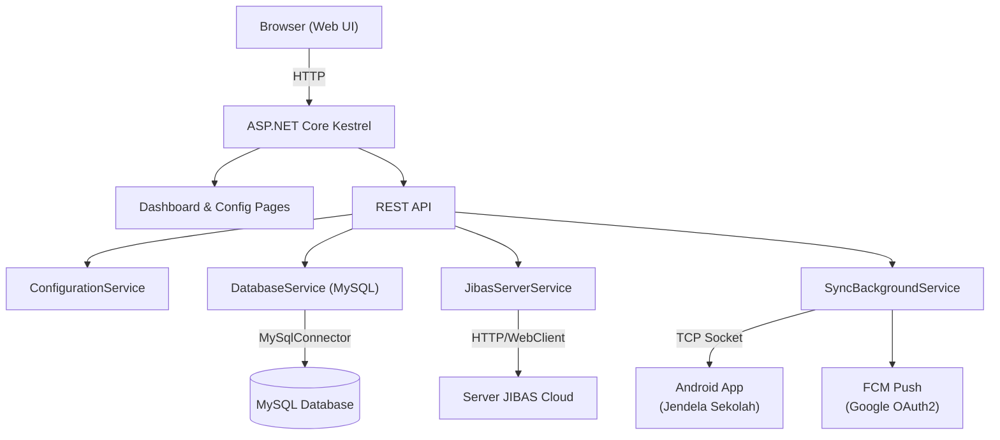

# 🏗️ JsSync-Linux — Rencana Pembangunan

## Ringkasan
Membangun ulang aplikasi **JIBAS SJS (Sinkronisasi Jendela Sekolah)** agar bisa berjalan di **Ubuntu tanpa GUI**, menggunakan **web interface HTTP** sebagai pengganti Windows Forms.

## Arsitektur

## Komponen Inti (Mapping dari JsSync Original)

| JsSync Original | JsSync-Linux | Fungsi |
|---|---|---|
| `Class224.Class228` | `DatabaseConfig` + `DatabaseService` | Connection string MySQL |
| `Class224.Class227` | `SchoolConfig` | Info sekolah (nama, tahun) |
| `Class224.Class229` | `ServerConfig` | Alamat & port server |
| `Class205` | `ConfigurationService` | Baca/tulis file konfigurasi |
| `Class280` | `DatabaseService` | Helper CRUD MySQL |
| `Class319` | `TcpServerService` | TCP server untuk Android |
| `Class303` | `ProtocolRouter` | Router protokol request |
| `Class194` | `JibasServerService` | Koneksi ke server JIBAS |
| `Class167` | `FcmTokenService` | Google OAuth2 + FCM token |
| `Class175` | `FcmService` | Push notification ke Android |
| `GClass41` | `ClientSession` | Handle koneksi per-client |
| `GForm17` | **Web Dashboard** | UI utama (HTML/CSS/JS) |

## Tech Stack
- **Runtime**: .NET 8 (cross-platform)
- **Web Server**: ASP.NET Core Kestrel
- **Database**: MySqlConnector (NuGet)
- **Frontend**: HTML5 + Tailwind CSS + vanilla JS
- **Config**: `appsettings.json` + file `jssync.conf`

## Fase Pembangunan

### Fase 1: Core Infrastructure ✅ (Sekarang)
- Project setup & structure
- Model konfigurasi
- DatabaseService (koneksi MySQL)
- ConfigurationService
- Web dashboard (HTML)

### Fase 2: Koneksi Server JIBAS
- JibasServerService (HTTP client ke cloud)
- Autentikasi & registrasi sekolah
- Status monitoring

### Fase 3: TCP Server & Protocol
- TcpServerService (socket listener)
- ProtocolRouter & handlers
- Client session management

### Fase 4: FCM & Notifikasi
- Google OAuth2 token refresh
- FCM push notification
- Notification queue

> [!IMPORTANT]
> Aplikasi ini menggunakan **ASP.NET Core** karena kode asli JsSync ditulis dalam C#, sehingga logika bisnis bisa diterjemahkan secara langsung. .NET 8 berjalan native di Ubuntu.
